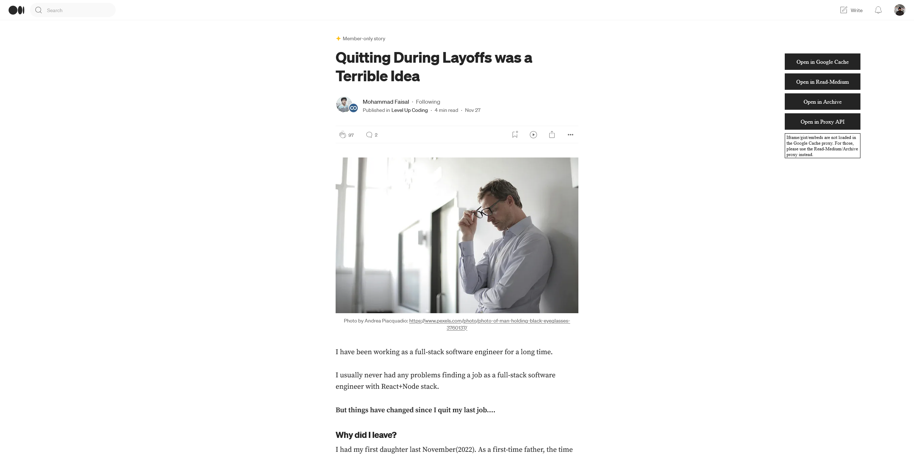

  

<h1 align="center">Medium Parser</h1>

  
  
  
  
  
  
  

Medium parser is a web browser extension to help read the member-only articles on medium.com and publications hosted on Medium, including those on their own domain.

### Upload Status
| Date    | Status |
| -------- | ------- |
| 24th September 2023  | Uploaded the first version to the Chrome Web Store    |
| 15th February 2024  | Taken down by the Chrome Web Store (40k+ DAU)   |
| 25th February 2024 | Uploaded a new version to the Chrome Web Store     |
| 8th September 2024    | Taken down by the Chrome Web Store (30k+ DAU)    |
| 16th October 2024    | Uploaded a new version to the Chrome Web Store    |

> DAU: Daily Active Users

## Installation Instructions
### Google Chrome / Microsoft Edge / Chromium Browsers (Brave/Opera Mini/Thorium etc.)
 

Or, Install manually
1. Download this repo as a [ZIP file from GitHub](https://github.com/Xatta-Trone/medium-parser-extension/archive/refs/heads/main.zip).
1. Unzip the file and you should have a folder named `medium-parser-extension-main`.
1. In Chrome/Edge go to the extensions page (`chrome://extensions` or `edge://extensions`).
1. Enable Developer Mode by clicking the toggle button on the top right side of the browser.
1. Drag the `chrome` folder anywhere on the page to import it (do not delete the folder afterward).

### Mozilla Firefox
 

 

### Troubleshooting
* The extension sends the article to a third-party reader (Freedium, Read-Medium, Archive.today or Archive.is). If one of them has no copy of the article or is down, try another one.

### Credits / Ideas
*  [This article on reddit.com](https://www.reddit.com/r/ChatGPT/comments/138jt64/you_can_read_medium_articles_for_free_using_bing/)

### Support 
Please consider a donation if you find this extension helps you daily.
Your contribution allows me to spend more time making this kind of extension/project.

 

## Preview

  

## Star History

